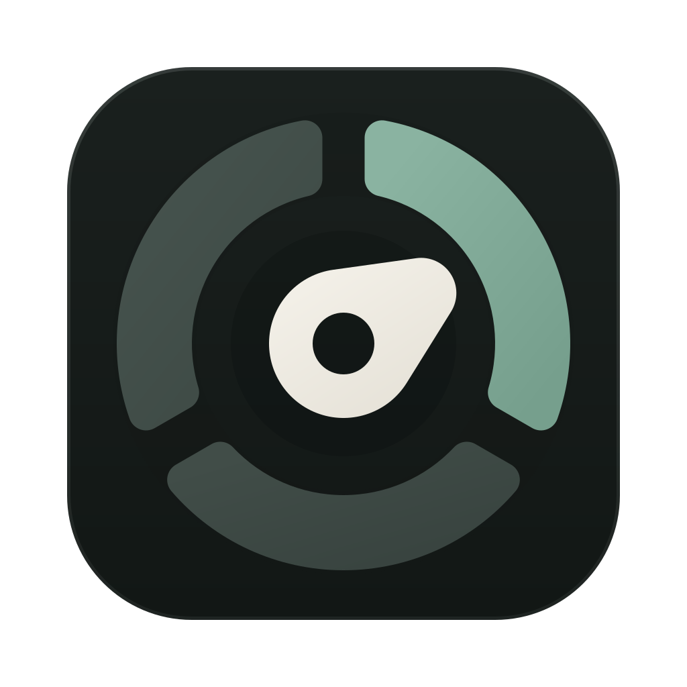
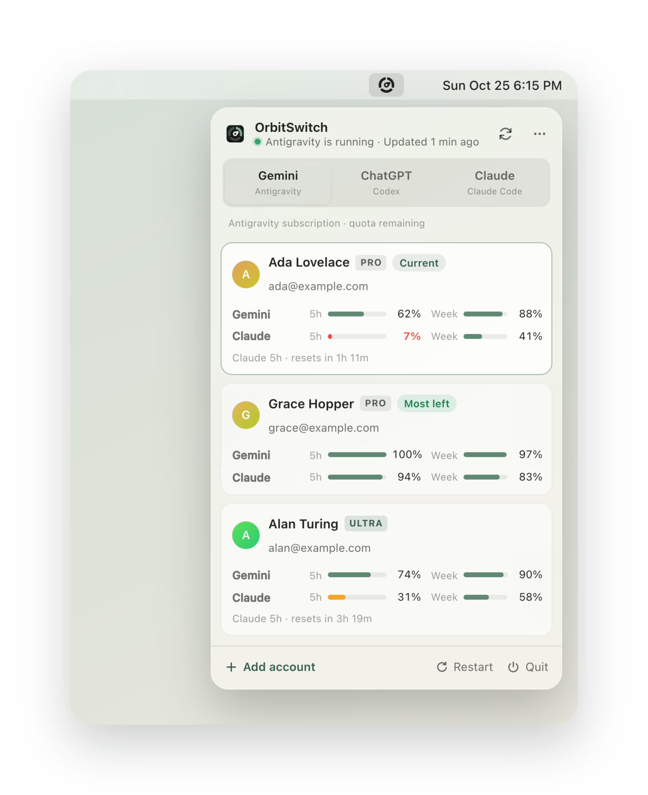

<h1 align="center">OrbitSwitch</h1>

切账号，看额度，继续工作。

<a href="README.md">English</a> · <a href="https://shengyy.github.io/orbitswitch/">官网</a> · <a href="https://github.com/shengyy/orbitswitch/releases">版本下载</a>

一个常驻菜单栏 / 系统托盘的小工具，管理**你自己的** Antigravity、Codex 和 Claude 账号。
三个 Tab，统一查看订阅套餐、剩余额度与重置时间。

<picture><source media="(prefers-color-scheme: dark)" srcset="assets/screenshots/hero-dark.png"></picture>

| Tab | 账号切换 | 订阅额度 |
|---|---|---|
| Gemini | Antigravity 桌面端 + `agy` CLI | Google 模型分组 |
| ChatGPT | Codex 桌面端 + CLI | Codex 限额窗口及额外额度池 |
| Claude | 关联登录后的 Claude Desktop + Claude Code | Claude 共享窗口及模型专属窗口 |

切换 Tab 只改变视图。切换账号前会确认要结束的客户端，写入后校验登录，失败时恢复原凭据，
然后打开已安装的桌面应用；CLI 会话需手动重开。额度刷新失败会保留旧数据并标明过期，
未返回的额度窗口不会猜测。这些是编程客户端额度，不代表 Gemini 或 ChatGPT 网页聊天额度。

Antigravity 切换、Codex 与 Claude 的身份及额度读取、Claude Desktop 关联均已在 macOS 实机验证；
Codex / Claude 的真实切换、浏览器添加登录及 Windows 原生行为仍**未验证**，详见[状态说明](docs/status.md)。

## 安装与使用

支持 macOS 26+、Windows 10/11 x64。请先安装需要管理的官方客户端；添加 Codex 或 Claude 账号还需
安装对应的官方 CLI。从 [Releases](https://github.com/shengyy/orbitswitch/releases) 下载安装包。

macOS 使用 ad-hoc 签名，尚未公证。首次打开若被拦截，可右键应用选择**打开**，或运行
`xattr -dr com.apple.quarantine /Applications/OrbitSwitch.app`。
Windows 安装包未签名，SmartScreen 提示时选择**更多信息 → 仍要运行**。

1. 从菜单栏或系统托盘打开 OrbitSwitch，选择平台 Tab。
2. **添加账号**打开官方登录，不改变当前客户端账号；**导入当前**保存本机已登录的账号。
   Gemini 如需使用无痕窗口或其他浏览器，在 OrbitSwitch 的等待界面点击**复制登录链接**，
   在同一台电脑打开，并在五分钟内完成登录。
3. Claude Desktop 需先与 Claude Code 登录同一账号和工作区，再导入。
4. 选择目标账号，核对受影响进程，确认后切换。

应用菜单提供开机启动、查看日志、检查更新和退出。更新只重启 OrbitSwitch。

从 AgyOrbit 或 OrbitSwitch 0.2.1 升级时，请关闭旧应用实例并安装 0.2.2 或更新版本。
已有账号与授权会自动迁移，也会保留 0.2.1 期间新增的账号；首次成功启动前，请保留旧账号数据和凭据库条目。

## 凭据留在本机

凭据和关联的桌面会话保存在 Rust 后端与系统凭据库，前端只接收账号元数据与额度快照。
OrbitSwitch 仅请求官方认证 / 额度接口与 GitHub Releases 更新；没有账号服务器、模型代理、自动切号或遥测。
详见 [SECURITY.md](SECURITY.md)、[PRODUCT.md](PRODUCT.md) 与 [CONTRIBUTING.md](CONTRIBUTING.md)。

MIT 开源。独立于 Google、OpenAI 和 Anthropic，相关产品名归各自所有者所有。
